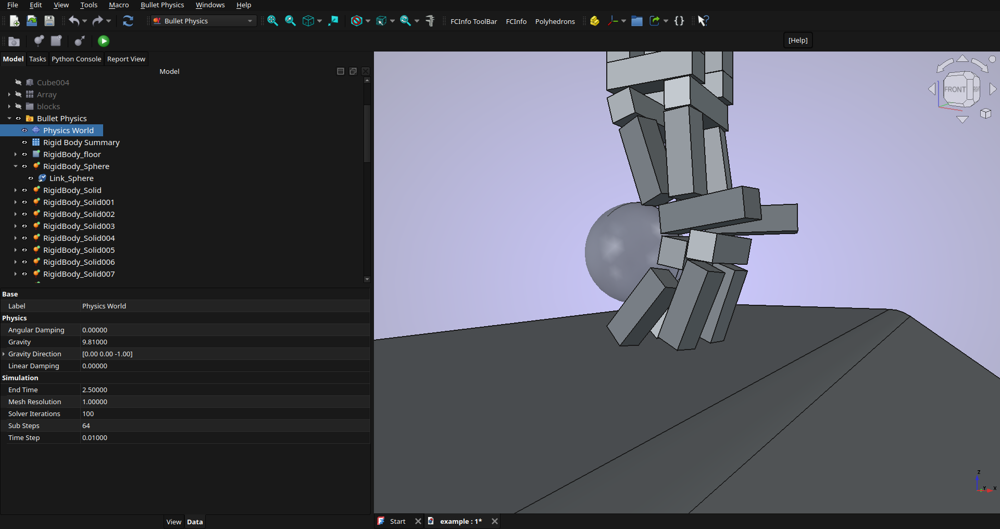
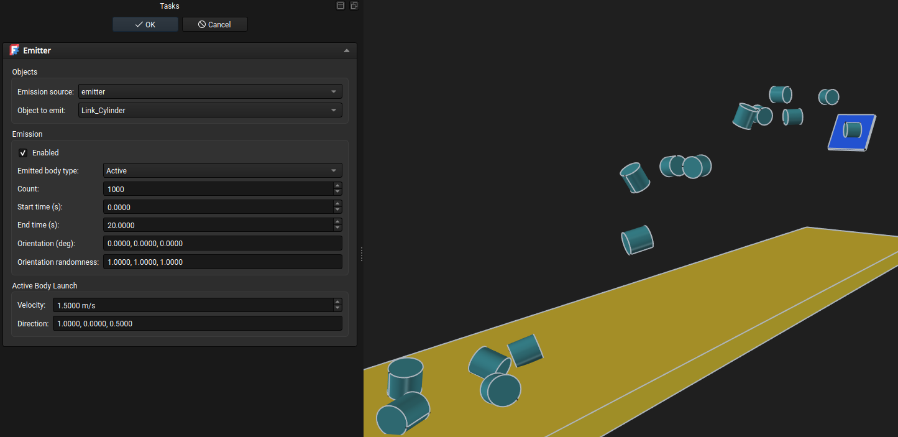
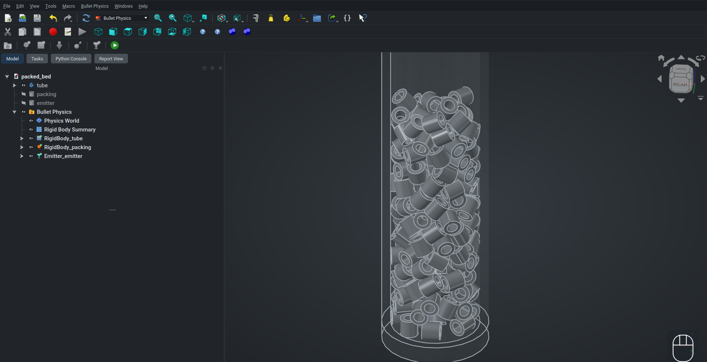

# FreeCAD Chrono Physics Workbench

A rigid-body physics simulation workbench for FreeCAD powered by [Project Chrono](https://github.com/projectchrono/chrono) through PyChrono. It keeps the commands, document model, panels, and workflow of FreeCAD-BulletPhysics while using Chrono for rigid-body dynamics and contacts.Code written with assistance from gpt-5.6-sol.

---

## Screenshots

Video tutorial in screenshot/tutorial.mp4








---

## Features

- **Dynamic & Fixed rigid bodies** — dynamic bodies are integrated by Chrono; fixed bodies use `ChBody::SetFixed(true)` (floors, walls, ramps)
- **Velocity Launcher** — Give dynamic bodies an initial velocity
- **Original geometry is never modified** — the workbench drives `App::Link` clones, leaving your original solids untouched and fully editable at all times
- **Automatic collision shape detection** — spheres, cylinders, and boxes get exact analytic collision shapes; any other solid is tessellated into a convex-hull or concave mesh automatically
- **Animation timeline** — scrubber, transport controls (first / step back / play-pause / step forward / last), adjustable playback speed (0.1× – 8×), and loop toggle
- **Simulation cache** — results are saved to disk alongside your `.FCStd` file so the timeline is available immediately on reopening the panel without re-running the simulation
- **Rigid Body Summary table** — editable overview of all bodies (type, density, friction, mesh type, mesh resolution) with bulk-apply inputs for changing multiple bodies at once
- **Bake frame as new origin** — commit any timeline frame back to the original objects as the new rest position; fully undoable with Ctrl+Z
- **Chrono System settings** — gravity magnitude and direction, simulation end time, frame time step, integration substeps, maximum solver iterations, and global tessellation settings, all stored in the document
- **Contact formulation and material** — select non-smooth contact (NSC, the default) or smooth penalty contact (SMC). Per-body and emitter material properties include static/sliding, rolling, and spinning friction; cohesion; NSC damping/compliance; and SMC elastic, adhesion, stiffness, and damping data.
- **Recursive downgrade** — Break down array of solids into individual components, useful when setting up a simulation with many solids as rigid body using array and need to separate them.

- **Emitter** — Emit multiple rigid-body objects in certain orientation or direction without manually duplicating rigid-body objects.

- **Destroy Rigid Body** — When touched, will be deleted/disabled. This can reduce unnecessary compute resources where rigid-body fell off the platform.
- **Observers and conditional events** — non-physical regions report body entry/exit, body type, speed, AND/OR conditions, delays, emitter start/stop events, and simulation stop conditions.
- **Setup-aware multicore execution** — the simulation panel inspects the configured geometry and installed Chrono version, then reports whether it can use multicore collision or must use a safe Bullet-collision fallback. Available Chrono/Eigen worker threads remain enabled in either mode.
- **Analytics and settling controls** — stop when all dynamic bodies settle, inspect speed data, and export the same cached animation/analytics data used by the original workflow.
---

## Requirements

| Requirement | Version |
|---|---|
| FreeCAD | 1.0 or later; tested with 26.3.0 weekly 2026-08-20 |
| Project Chrono / PyChrono | 10.0.0; tested with the openSUSE `python3-pychrono` package |
| Helper Python | Python matching the PyChrono package (Python 3.13 on current Tumbleweed) |

---

## Installation

### 1 — Install PyChrono

On openSUSE Tumbleweed, install the PyChrono RPM built with Project Chrono:

```bash
sudo zypper install python3-pychrono
```

The supplied FreeCAD AppImage embeds Python 3.11 while Tumbleweed PyChrono uses Python 3.13. The workbench detects this automatically and keeps `/usr/bin/python3.13` running as a local Chrono worker. To select another compatible interpreter:

```bash
export FREECAD_CHRONO_PYTHON=/path/to/python-with-pychrono
```

When FreeCAD and PyChrono use the same Python ABI, the workbench uses PyChrono directly without the worker.

### 2 — Install the workbench

**Option A — FreeCAD Addon Manager (recommended once listed)**

Open FreeCAD → Tools → Addon Manager → search for **Chrono Physics** → Install.

**Option B — Manual**

Clone this repository into your FreeCAD `Mod` folder:

```bash
# Linux / macOS
cd ~/.local/share/FreeCAD/Mod        # FreeCAD 1.x path
# or ~/.FreeCAD/Mod for older versions
git clone https://github.com/kevinsmia1939/FreeCAD-Chrono

# Windows
cd %APPDATA%\FreeCAD\Mod
git clone https://github.com/kevinsmia1939/FreeCAD-Chrono
```

Restart FreeCAD and select **Chrono Physics** from the workbench dropdown. For the FreeCAD build used during development, this repository is installed at `~/.local/share/FreeCAD/v26-3/Mod/FreeCAD-Chrono`.

---

## Quick Start

1. Open or create a FreeCAD document containing at least one solid.
2. Switch to the **Chrono Physics** workbench.
3. Click **Create Physics Container** — this adds a *Chrono Physics* folder to the model tree containing a *Chrono System* settings object and a *Rigid Body Summary* table.
4. Select a solid in the 3D view, then click **Add Dynamic Rigid Body** (integrated by Chrono) or **Add Fixed Rigid Body** (a `ChBody::SetFixed(true)` collider).
5. Repeat step 4 for each solid you want to simulate.
6. Adjust physics properties in the **Chrono System** object (gravity, end time, time step, etc.) and per-body properties (density, friction, restitution) via the model tree or the Rigid Body Summary table.
7. Click **Run Simulation** in the toolbar to open the simulation panel.
8. Click **Simulate** — a progress bar tracks the run. When it finishes the timeline slider is enabled.
9. Drag the slider or press **Play** to watch the animation.

The `example` directory contains migrated Chrono versions of both original `.FCStd` examples.

## CPU multithreading compatibility

The **Enable CPU parallelization** option is setup-aware. The simulation panel shows the selected mode and the exact reason for any fallback before the simulation starts.

| Simulation setup | Collision mode | Threading used |
|---|---|---|
| Primitive collision shapes only (box, sphere, cylinder) | Chrono `MULTICORE` | Multicore collision plus Chrono/Eigen worker threads |
| Fixed analytical cylindrical shell contacted by cylinders | Chrono `MULTICORE` | Patched primitive cylinder–shell narrowphase plus Chrono/Eigen worker threads |
| Fixed concave mesh contacted only by spheres or boxes | Chrono `MULTICORE` | Chrono 10 has dedicated triangle–sphere and triangle–box contact paths; Chrono/Eigen threads are also enabled |
| Fixed concave mesh contacted by cylinders, capsules, convex hulls, or other custom dynamic geometry | Chrono `BULLET` fallback | Chrono/Eigen worker threads remain enabled, but collision detection is not multicore |
| PyChrono build without the `MULTICORE` collision type | Chrono `BULLET` fallback | Only the Chrono/Eigen threading exposed by that build |
| CPU parallelization disabled | Chrono `BULLET` | No threading requested by the workbench |

The cylinder/concave-mesh fallback is required by Chrono 10: its multicore narrow phase sends triangle–cylinder and similar pairs through a generic convex contact path which can falsely bridge real openings and cavities. The panel names the affected fixed mesh and dynamic geometry. The current openSUSE PyChrono 10.0.0 bindings also do not expose `ChSystemMulticoreNSC`; therefore “multicore” means multicore collision plus threaded Chrono/Eigen work, not a replacement of the complete NSC dynamics system.

### Analytical cylindrical particle bed

To use the patched non-mesh cylinder bed:

1. Make the container a **Fixed** rigid body.
2. Set its **Collision Shape** to `cylindrical_shell` in the Rigid Body Summary or its `ShapeOverride` Data property.
3. Leave `CylindricalShellRadius` at 0 mm to infer the smallest cylindrical-face radius, or enter the exact inner radius.
4. Leave `CylindricalShellHeight` at 0 mm to use the body-local Z extent. For a thick bottom, enter the cavity height and use `CylindricalShellAxialOffset` to align its centre with the cavity.
5. Enable `CylindricalShellBottomCap` and disable `CylindricalShellTopCap` for an open-top bed.
6. Use analytical `cylinder` collision shapes for the dynamic particles and enable **CPU parallelization** in the Simulation panel.

The shell axis is body-local Z and its bottom/top caps are respectively local -Z/+Z. The setup detector reports a red blocking message if the patched Chrono API is missing, CPU parallelization is disabled, the shell is Dynamic, or non-cylinder dynamic geometry is present. `NSC` is recommended for a dense rigid-particle bed. The workbench automatically uses true Chrono cylinder primitives in this mode; legacy cylinder-versus-triangle-mesh scenes retain the 24-sided convex workaround.

## Current differences from the Bullet backend

These are limitations of the current PyChrono integration, rather than general limitations of Chrono's C++ engine:

- PyChrono 10 does not expose the V-HACD helper bundled with PyBullet. A dynamic body explicitly set to a concave mesh therefore falls back to a single convex hull. Static concave triangle meshes remain exact.
- Chrono 10's analytic cylinder/triangle contact is unstable for concave mesh containers. Legacy mesh-bed cylinders are represented by a 24-sided convex prism (under 1% radial error). A configured analytical cylindrical shell instead uses the patched true cylinder primitive and capped-shell contact path.
- The installed bindings do not expose `ChSystemMulticoreNSC`. Where the setup detector permits it, CPU parallelization uses Chrono's `MULTICORE` collision system and threaded Chrono/Eigen core, but the NSC dynamics system itself is not replaced by the separate multicore-system class.
- PyBullet's per-body CCD controls do not have a direct equivalent in the bound Chrono API used here. Concave-mesh scenes therefore receive automatic, scale-aware internal collision substeps; the Chrono System timestep and playback rate do not change.
- Query-only observer boundary checks use exact FreeCAD point-in-solid containment plus a conservative bounding-radius proximity test. PyBullet can provide an exact `getClosestPoints` query for two disabled-response collision objects.
- Chrono requires an inertia tensor. Analytic boxes, spheres, and cylinders use their exact diagonal inertia; arbitrary meshes and compounds use a stable spherical estimate, which can produce somewhat different rotation from Bullet's inferred mesh inertia.
- With the supplied AppImage, pipe-based bridging adds some overhead compared with an in-process PyChrono module. It does not change simulation results and disappears when both programs use the same Python ABI.

## License

GPL-3.0-or-later — see [LICENSE](LICENSE).
